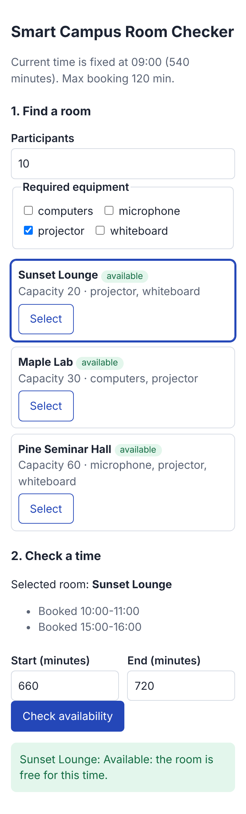
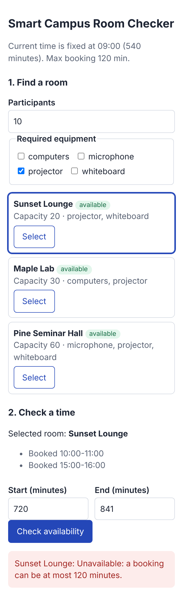
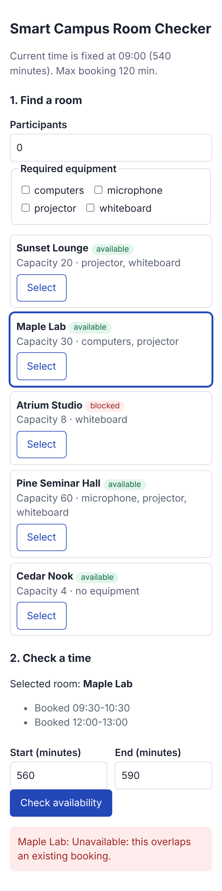
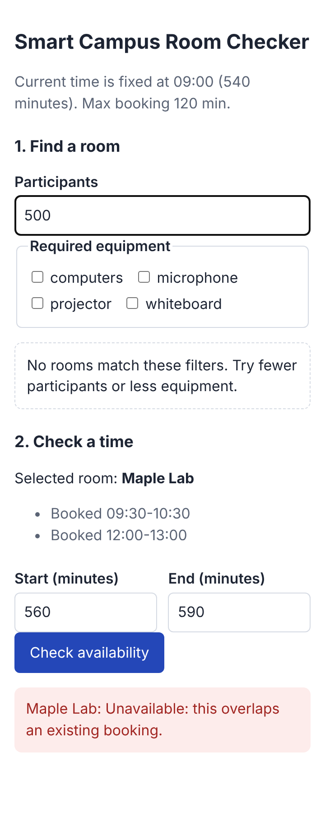
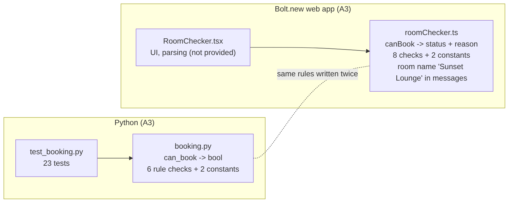
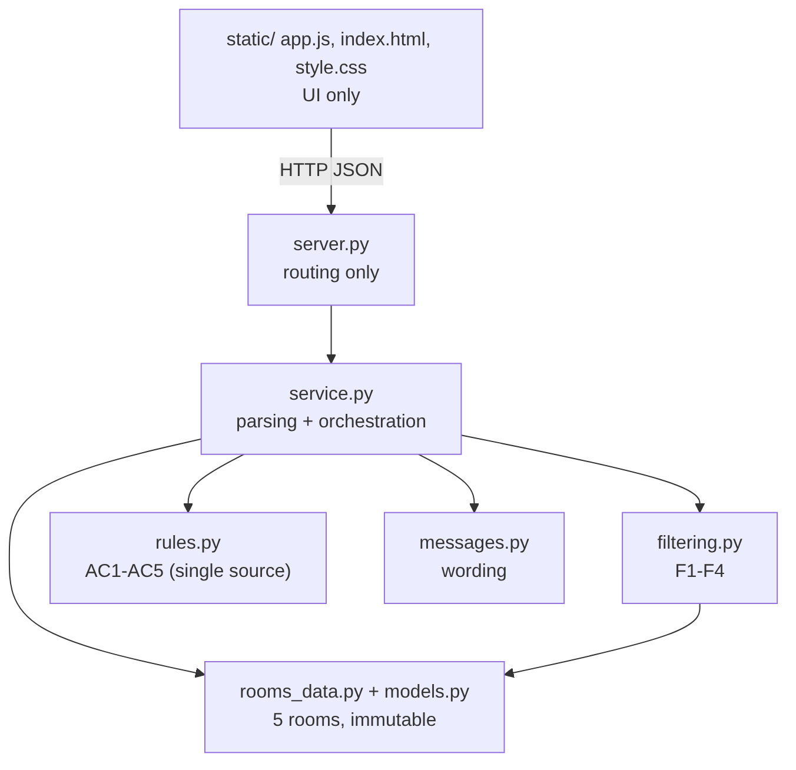

**Student:** Zhutanov Farkhat (ID 24B031797)  **Date:** 8 November 2026
**AI assistant:** Claude Sonnet 5.5 (this assignment); baseline from A3 built with Bolt.new (project https://bolt.new/p/72186442, model shown: Standard) and Claude Sonnet 5.5 for Python. **Stack:** Python 3.13 standard library, plain HTML/CSS/JS.

# 1. Codebase analysis (Task 1)

**Context given to the AI:** the assignment PDF, my A3 report (AC1-AC6, function contract, issue log), and my real A3 files `booking.py`, `test_booking.py` and `roomChecker.ts`, plus the limits (one page, fictional data, no login/DB/payments). **Repository map (baseline = my Assignment #03 work):**

| File | Role |
|---|---|
| `baseline/booking.py` | Python `can_book(start, end, now, blocked, existing) -> bool` (AI v1, unchanged) |
| `baseline/test_booking.py` | my 23 A3 tests of `can_book` |
| `baseline/roomChecker.ts` | Bolt.new rule logic (project https://bolt.new/p/72186442): `validateInput`, `canBook -> {status, reason}`, `DEFAULT_BOOKINGS` |
| `RoomChecker.tsx`, `App.tsx` (Bolt) | UI and input parsing; **not included in this repository copy**, so they are not analysed or measured here |

**Maintainability risks (found by reading the real files)**

| # | Risk | Where | Why it matters |
|---|---|---|---|
| R1 | The same rules are implemented twice, in two languages (blocked, whole numbers, day bounds, start after now, max length, overlap = 6 rules, 12 implementation sites) | `booking.py: can_book`, `roomChecker.ts: validateInput + canBook + intervalsOverlap` | a fix in one copy can be forgotten in the other |
| R2 | The two copies do not behave identically in detail: Python checks `blocked` first and returns a bool; TS validates input first and returns a reason | `booking.py` lines 25-32, `roomChecker.ts: canBook` | same input can give different reasons, contract differs |
| R3 | Constants defined twice (`MINUTES_PER_DAY`/`MINUTES_IN_DAY`, `MAX_DURATION`/`MAX_DURATION_MINUTES`) | `booking.py` lines 3-4, `roomChecker.ts` lines 23-24 | changing a limit needs two edits in two languages |
| R4 | One room is hard-coded: the name "Sunset Lounge" is inside messages and bookings are a single `DEFAULT_BOOKINGS` | `roomChecker.ts: canBook`, `DEFAULT_BOOKINGS` | cannot add rooms or filters without editing rule code |
| R5 | Rule function returns only True/False in Python, so no reason is available | `booking.py: can_book` | messages must be re-invented elsewhere (already noted in A3 limitations) |

**Plan before editing code:** (1) one `rules.py` returning a reason code, keeping the `can_book` contract; (2) immutable `Room` data in its own module; (3) filtering as pure functions; (4) wording in `messages.py`; (5) strict parser + orchestration in `service.py`; (6) UI only renders; (7) run my 23 A3 tests against the new rules after every step.

**AI suggestion rejected/modified:** the first filter design dropped blocked rooms from the results. I changed it so blocked rooms stay visible with status "blocked" (F3: never "available"), because a student should see why a room is not offered. Also rejected: my first F5 test intervals (see section 4).

# 2. Feature extension (Task 2)

Catalog of 5 rooms (`rooms_data.py`): Sunset Lounge (20, projector+whiteboard), Maple Lab (30, computers+projector), Atrium Studio (8, whiteboard, **blocked**), Pine Seminar Hall (60, projector+microphone+whiteboard), Cedar Nook (4, no equipment). Old rules AC1-AC5 are unchanged and still run in `rules.py`.

| Requirement | Implementation |
|---|---|
| F1 capacity >= participants | `filtering.matches` |
| F2 ALL selected equipment | subset test `set(required) <= room.equipment` |
| F3 blocked never available | status `blocked` in `filter_rooms`; `rules.BLOCKED` on check |
| F4 empty state | `empty: true` from service, message in the page |
| F5 room switch re-checks with own bookings | `check_room(room, ...)` uses `room.bookings`; `selectRoom()` re-runs check |

Screenshots (360 px wide): successful check, failed check, switching, empty state.

{width=30%} {width=30%}

{width=30%} {width=30%}

Switching result (captured by script): `Sunset Lounge: Available` vs `Maple Lab: Unavailable: this overlaps an existing booking.` for the same 560-590.

# 3. Refactoring (Task 3)

**Before:**

{width=80%}

**After:**

{width=70%}

**Design decisions**

1. *Rules in one module returning a reason code.* Removes the duplicated Python/TS copies (R1, R2, R5); the UI no longer decides anything, it displays `message`. Trade-off: the UI now needs the server running.
2. *Immutable `Room` with tuple bookings.* AC5 (bookings never change) holds by construction, and a room carries its own bookings, which makes F5 simple. Trade-off: editing bookings later means creating new objects.
3. *Parsing in `service.py`, not in the UI.* The strict digits-only parser (rejects `1e3`, `0700`, `0x10`, `720.5`) fixes the A3 Issue 1 class of bug in one place.

Behaviour was preserved: my **23 original A3 tests** (`baseline/test_booking.py`) run unchanged against the new `rules.can_book` (copy in `tests/test_a3_regression.py`, only the import line differs) and all 23 pass.

# 4. Automated tests (Task 4)

Command: `python3 -m unittest discover -s tests -t . -v`. Real result (saved in `docs/test_run_final.txt`): **Ran 48 tests ... OK** (48 passed, 0 failed, about 0.5 s). Baseline: `cd baseline && python3 -m unittest test_booking -v` -> **Ran 23 tests ... OK** (`docs/test_run_baseline.txt`).

| Area | Tests | Boundary covered |
|---|---|---|
| My original A3 tests on the new rules (`test_a3_regression.py`) | 23 | AC1-AC5 incl. 120 vs 121, touching, 1440 vs 1441, start == now, unsorted bookings, types, no mutation |
| AC1-AC5 regression, new (`test_rules.py`) | 8 | reason codes; 660-720 and 541-600 touching 600-660; blocked |
| F1-F4 (`test_filtering.py`) | 6 | capacity exactly equal vs one more; all equipment vs one missing; blocked; empty |
| Service integration incl. F5 (`test_service.py`) | 7 | per-room bookings, strict parser (`1e3`, `0700`, `0x10`, `720.5`), friendly messages |
| HTTP/UI integration (`test_http_ui.py`) | 4 | page served with viewport, filter->check flow, room switch, empty state |

**Test failure found during work:** the first run of my 25 new tests gave 23 passed, 2 failed (`test_f5_same_time_different_result_per_room`, `test_switching_rooms_changes_result`). Cause: my test interval 570-630 overlaps Sunset's 600-660 booking, so it was never free there. The code was right; I changed the interval to 560-590 and the new tests became 25/25. Manual checks (not automated): 360 px layout had no horizontal scroll (`scrollWidth` = 360) and the screenshots above.

# 5. Quality evaluation (Task 5)

| Metric | Baseline (A3) | Final | How measured |
|---|---|---|---|
| Tests passed / total | 23 / 23 | 48 / 48 (23 of them are the A3 tests) | `unittest` output, logs in `docs/` |
| Implementations of the 6 rules (blocked, whole numbers, day bounds, start after now, max length, overlap) | 12 (6 in `booking.py` + 6 in `roomChecker.ts`) | 6 (all in `rules.py`) | counted by reading `can_book`, `validateInput`, `canBook`, `intervalsOverlap`, `check_interval` |
| Constant definitions (1440, 120) | 4 (2 per language) | 2 (`rules.py`) | `grep -nE "MINUTES_PER_DAY\|MAX_DURATION\|MINUTES_IN_DAY\|MAX_LENGTH"` |
| Room name hard-coded inside rule messages | 2 places (`roomChecker.ts`) | 0 (rooms are data) | reading `canBook` |
| Rooms supported | 1 | 5 | `rooms_data.py` |
| Modules and responsibility | 2 rule files (Python, TS) each mixing rules, messages and (TS) data | 7 Python modules + 3 static files, one job each | file listing |

So **6 duplicated rule implementations and 2 duplicated constant definitions were removed**. Limits of the measurement: the Bolt UI files (`RoomChecker.tsx`, `App.tsx`) were not part of this repository copy, so their duplication is not counted; counts are by reading code, not by a tool.

**Remaining limitations:** bookings live in memory only (no persistence); `now` is fixed; malformed `existing` entries are not validated; no real browser automation test (the UI is checked by HTTP tests, a Playwright script and screenshots; the old Bolt UI was replaced, not migrated); the UI shows only minutes as input.

# 6. AI reflection (Task 6)

See `REFLECTION.md` (copied below).

I gave Claude Sonnet 5.5 the assignment PDF, my Assignment #03 report with the acceptance criteria AC1-AC6, and the constraints: one page, fictional data, no login or database, and the old rules must keep their exact meaning. I asked for a repository map, risks and a plan before any code.

Useful suggestions: one rules module as the single source of truth, immutable rooms so bookings cannot change, a strict whole-number parser that rejects 1e3 and 0700, and a thin UI that only displays what the service returns. The first version of my F5 tests was wrong: I used 570-630 for "free in Sunset Lounge", but it overlaps Sunset's 600-660 booking. The failing test pointed at the test data, not the rule code, so I corrected the interval to 560-590. I also changed the first filter design, which hid blocked rooms, so blocked rooms are shown with a "blocked" status instead and can never be "available".

What I checked myself: I ran all 48 tests (including my 23 original A3 tests) and the A3 suite on its own, counted rule implementations and constants, opened the page at 360 px width and confirmed there is no sideways scroll, and compared the same time in two rooms. I did not trust a passing test run on its own, since A3 showed that logic tests can pass while the UI is wrong.

Tests drove two decisions: moving all parsing into service.py, and keeping the 120 vs 121 and touching vs overlapping cases as explicit tests during the refactor.

Next I would add a real browser test, store bookings in a file, and let the UI show the reason for each filtered-out room.
